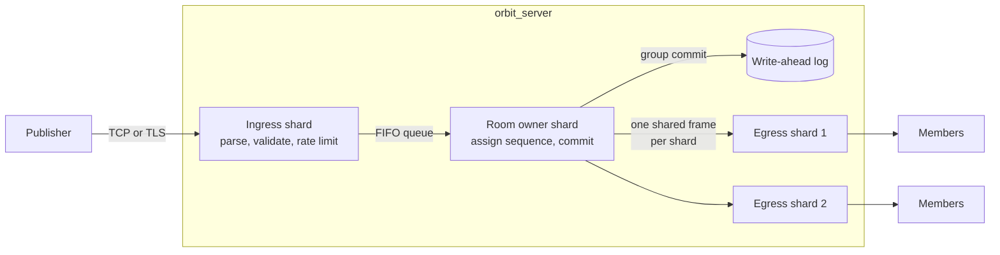

# Orbit

[](https://github.com/Elarionitis/Orbit/actions/workflows/ci.yml)


A sharded, durable, real-time chat server in modern C++, written from the socket up
with no frameworks. It has its own epoll and kqueue reactor, binary wire protocol,
write-ahead log and load generator. OpenSSL is the only runtime dependency, and that
is optional.

**Every member of a room sees the same messages in the same order and, with
`--fsync always`, an acknowledged message survives `kill -9`.** Both claims are enforced
by tests.

| Measured over loopback, generator on the same host ([details](docs/BENCHMARKS.md)) | |
|---|---:|
| Peak fan-out, 100 clients in one room (Linux VM, 3 server threads) | **17.4M deliveries/s** |
| Peak throughput, 100 clients across 10 rooms (same) | **686k messages/s** in, **6.9M/s** out |
| Latency at 1,000 clients and 200k deliveries/s (same) | **p50 0.08 ms, p99 0.20 ms** |
| Durable writes at 5k msg/s, flushed to a real SSD before acknowledging (macOS) | **p99 6.6 ms** |
| Messages lost in the benchmark suite, on either platform | **0** |
| Acknowledged messages lost after repeated `SIGKILL`, `--fsync always` | **0** |

## Features

**Server core**
- One event loop per thread over epoll or kqueue, with no locks on the message path
- Rooms sharded across threads, each with a single writer, giving a total order per room
- Vectored writes, coalesced once per loop iteration, of frames shared by all recipients
- Hashed timing wheel for O(1) timers, used for connection and handshake deadlines

**Durability**
- Segmented write-ahead log with CRC-32C records and group commit
- Three `fsync` policies, from fastest to strictly durable
- Crash recovery that truncates torn writes, and survives damage in older segments

**Chat**
- Rooms, direct messages, presence, and member and room listings
- Replay on join, with a gap-free handover from history to the live stream
- Clients reconnect with jittered backoff and catch up from their last sequence number

**Production behaviour**
- TLS 1.2+ through OpenSSL, on a sans-IO layer so the reactor never blocks inside it
- Bounded output queues: one stalled client is cut off and nobody else notices
- Per-client rate limiting, load shedding, and limits on frames, rooms and connections
- Prometheus metrics, a health endpoint, and graceful shutdown on `SIGTERM`

## Quick start

Requires CMake 3.21+, Ninja, a C++20 compiler and OpenSSL. GCC 13, Clang 18 and Apple
Clang 21 are the compilers it has been tested with.

```bash
cmake --preset release
cmake --build --preset release

# Terminal 1: a server with persistence and metrics
./build/release/src/server/orbit_server --data-dir data --metrics-port 9090

# Terminals 2 and 3
./build/release/src/client/orbit_client --nick ada
./build/release/src/client/orbit_client --nick grace
```

Inside the client, type to chat, or use `/join <room>`, `/leave`, `/switch <room>`,
`/who`, `/rooms`, `/msg <nick> <text>`, `/help` and `/quit`.

Or with Docker:

```bash
docker build -t orbit .
docker run -p 8080:8080 -p 9090:9090 -v orbit-data:/data orbit
```

## How it works



Each shard is a single thread that owns a set of connections and the rooms that hash
to it. Exactly one thread ever writes to a room, and all traffic between shards goes
through FIFO queues, so ordering falls out of the structure: there is nothing to lock
and no way for two members to disagree. Joining travels through the same queues, which
is what makes the handover from history to live messages exact.

[docs/ARCHITECTURE.md](docs/ARCHITECTURE.md) explains the design and its trade-offs,
and [docs/PROTOCOL.md](docs/PROTOCOL.md) specifies the wire format.

## Testing

185 tests, run on Linux (GCC and Clang) and macOS (Apple Clang).

| Technique | What it covers |
|---|---|
| Unit tests | Every primitive, with RFC 3720 vectors for CRC-32C |
| Integration tests | A real server over real sockets: ordering, replay, abuse, TLS, reconnection |
| Crash tests | `SIGKILL` a real process under load with `fsync=always`, five times, then audit the log |
| Torn-write tests | Recovery with the log cut at every byte offset of the final record |
| AddressSanitizer, UBSan, ThreadSanitizer | The whole suite, on both platforms |
| libFuzzer | The stream decoder and log recovery |
| Delivery audit | Every load test checks sequence numbers and delivery counts |

```bash
ctest --preset release          # or debug, asan, tsan after building that preset
```

## Benchmarking

```bash
./build/release/src/bench/orbit_bench --clients 1000 --rooms 50 --rate 10000
scripts/run_benchmarks.py build/release     # the full suite
```

The generator is open-loop by default when given a rate, so a stall in the server shows
up as latency rather than hiding behind coordinated omission. A run exits non-zero if
any message went missing.

## Configuration

```bash
orbit_server --help
```

| Goal | Flags |
|---|---|
| Durable writes | `--data-dir DIR --fsync always` |
| TLS | `--tls-cert cert.pem --tls-key key.pem`, then `orbit_client --ca cert.pem` |
| Require a shared token | `--auth-token-file FILE`, then `orbit_client --token-file FILE` |
| Monitoring | `--metrics-port 9090`, then scrape `/metrics` and probe `/healthz` |
| Bound disk usage | `--wal-segment-mb 64 --wal-max-segments 16` |

## Project layout

```text
src/common/     Buffers, CRC-32C, timing wheel, rate limiter, logging, metrics
src/protocol/   Wire format: framing, messages, validation
src/net/        Reactor: pollers, event loop, connections, TLS
src/storage/    Write-ahead log
src/server/     Shards, rooms, sessions, admin HTTP
src/client/     Reconnecting client library and terminal interface
src/bench/      Load generator
tests/          Unit and integration tests
fuzz/           libFuzzer targets
scripts/        Benchmark suite and legacy comparison
```

## Limitations

Orbit is a single-node server, and these are deliberate scope limits rather than
oversights:

- No replication: durability is per node, so a lost disk loses its data.
- Authentication is one shared token, not per-user accounts.
- Direct messages are relayed live and are not persisted.
- Replay is served from a bounded in-memory window. The log holds more, but is only read
  at startup, and startup time grows with the retained log.
- Without `--fsync always`, a message is acknowledged before it reaches the log, so a crash
  can lose the last few acknowledged messages.
- An unacknowledged publish is not retried automatically, as the client has no way to know
  whether it was committed. Catching up after a reconnect is limited to the replay window.

## License

MIT. See [LICENSE](LICENSE).
