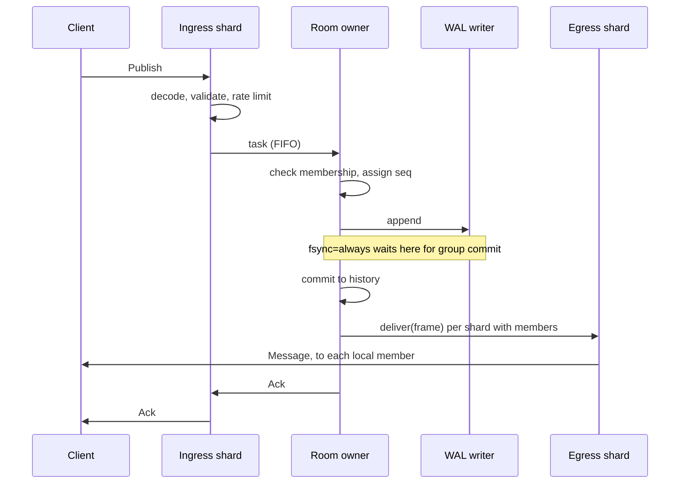

# Architecture

This document explains how Orbit is put together and, more importantly, why. Each
section ends with the trade-off that was accepted.

## Threading model

A server runs N shards, one per thread. A shard is an event loop with two roles:

- **Session role.** It owns a set of client connections, assigned round-robin at accept,
  plus a local table of which of them subscribe to which room.
- **Room role.** It owns every room whose name hashes to it, and is the only thread that
  ever touches that room's state.

Threads share almost nothing. The exceptions are the immutable configuration, the
striped metrics, and two small registries (nicknames and the room list) that are off the
message path. Everything else moves between threads as tasks in FIFO queues: work goes
to the data, rather than locks protecting data from work.

*Trade-off:* a message crosses up to two queues, costing a little latency compared with a
shared-memory broadcast. It buys lock-free room state and the ordering guarantee below.

## The life of a message

The message is serialised once, by the owner, into an immutable reference-counted frame.
Fan-out then costs one reference count per recipient and no copies, however large the room.

Writes are not issued as they are produced. A connection appends to its output queue and
asks for a flush at the end of the loop iteration, so everything that arrived during
that iteration leaves in one `sendmsg` with an iovec array. A profile of the server on macOS
shows about 70% of its time inside the kernel's `sendmsg`, so the number of syscalls is
what matters.

## Why every member sees the same order

This is the design's central claim, and it needs only two facts:

1. A room has exactly one writer, which assigns sequence numbers in a single thread.
2. A shard's task queue is FIFO for each producer.

The owner sends messages to each egress shard in sequence order. Fact 2 means each
egress shard receives them in that order, so every member in the system sees sequence
numbers in the same order. Nothing has to be sorted, buffered or compared.

`AllMembersSeeOneTotalOrderUnderConcurrency` tests this directly, with eight publishers
and six readers spread across shards.

## Joining without a gap

A joining client must see every message exactly once: history up to some point, then the
live stream. The classic bug is a window between reading history and subscribing.

Here, the owner handles a join as one step. It adds the member, snapshots the retained
history, and sends subscription and history to the session's shard as a single task. Any
later message is fanned out afterwards through the same FIFO queue, so it necessarily
arrives after the subscription. There is no window to race through.

`Joined.head_seq` tells the client where history ends and live begins, and
`Joined.first_seq` tells it if older messages have aged out.

## The reactor

`EventLoop` runs four phases per iteration: dispatch socket readiness, run posted tasks,
fire timers, run deferred work. Deferring flushes to the last phase is what batches writes.

**Level-triggered, not edge-triggered.** Edge-triggered polling saves some syscalls, but
requires draining every socket to `EAGAIN`, which lets one fast sender monopolise a loop.
Level-triggered lets a connection do one bounded read and yield, giving fairness by
construction. A reactor's `epoll_ctl` traffic stays low anyway, since write interest is
only armed when the kernel buffer is actually full.

**One acceptor rather than `SO_REUSEPORT`.** Chat connections are long-lived, so accept
rate is not a bottleneck, and round-robin gives an even spread that kernel hashing does
not. It also behaves identically on macOS, where `SO_REUSEPORT` does not balance load.

**A mutex-guarded task queue rather than a lock-free one.** The consumer swaps the whole
queue out under the lock, so it takes the lock once per batch, producers hold it only for a
push, and only the first post of a batch pays for a wake-up syscall. With the kernel send
path dominating the profile, a lock-free queue would add risk for little to gain.

**Timers.** A hashed timing wheel gives O(1) schedule and cancel. Connection activity
does not touch it at all: traffic only updates a timestamp, and the timer re-arms itself
for the remainder if it wakes early.

**Connection lifetime.** `close()` releases the socket immediately but reports through
`on_close` from deferred work, once the current event batch can no longer reference the
object. Deferred work holds a liveness token, so destroying a `Connection` is safe at any
moment on its loop thread.

## Backpressure and overload

Every queue in the system is bounded, so overload has a defined outcome everywhere:

| Pressure | Response |
|---|---|
| Client reads too slowly | Output queue passes its limit; that client is disconnected and can catch up |
| Client sends too quickly | Token bucket refuses; persistent floods are disconnected |
| Room's shard is backed up | Publish refused with `Overloaded`, before it joins the queue |
| Log writer falls behind | Backlog limit refuses appends with `Overloaded` |
| Too many connections | Refused at accept with `ServerFull` |
| Out of file descriptors | A spare descriptor is released to accept and shed the connection |

Disconnecting a slow consumer sounds harsh, but the alternatives are worse. Buffering
without limit runs the server out of memory, and blocking stalls everyone. The original
version of this server blocked: one frozen client stopped delivery to every other client
completely. Sequence numbers make the disconnect safe, since the client resumes where it
left off.

## Durability

Each record is `u32 length | u32 CRC-32C | payload`, in segments that start with a magic
number and version.

A dedicated thread owns the file. It drains everything queued into a single `write`
and, for `fsync=always`, a single `fsync`. This is group commit: one sync covers the whole
batch, so throughput rises with load while the guarantee stays the same.

| Policy | Acknowledged | Process crash can lose | Power loss can lose | Latency cost |
|---|---|---|---|---|
| `none` | Once queued | Records queued for the writer | Whatever the OS had not flushed | None |
| `interval` | Once queued | Records queued for the writer | Up to one interval, plus the queue | None |
| `always` | After `fsync` | Nothing acknowledged | Nothing acknowledged | One `fsync`, shared by the batch |

Only `always` makes an acknowledgement a promise. With the other two, the writer thread
has not yet seen a record when its `Ack` is sent, so `kill -9` can lose the queued tail even
though the kernel would have kept anything already written. The trade is lower latency for
a small window of loss.

With `always`, a message is neither delivered nor acknowledged until it is durable. A
client can therefore never read something a crash later retracts. On macOS the log uses
`F_FULLFSYNC`, because plain `fsync` there stops at the drive's volatile cache.

**Recovery.** Records are replayed in order until one fails its length or CRC check. In the
newest segment, that is what a crash leaves behind, so the tail is truncated. In an older
segment it means real damage, so the rest of that segment is skipped and reported, while
the server still starts and newer segments still load.

Each new segment opens by restating every room's head sequence. Without this, deleting
old segments could rewind a quiet room's sequence, and a reconnecting client would
silently skip new messages that reused an old number.

A failed `fsync` marks the log as failed rather than retrying. After such a failure the
kernel may have discarded the dirty pages, so a retry could report success for data that
never reached the disk.

## TLS

`SecureChannel` is a sans-IO interface: bytes in, bytes out, no sockets. The OpenSSL
implementation runs on memory BIOs, so `WANT_READ` and `WANT_WRITE` never reach the I/O
path, and plain and TLS connections share one socket code path.

*Trade-off:* a broadcast must be encrypted per recipient, so TLS connections give up the
zero-copy fan-out.

## Observability

Hot counters are striped across cache lines and summed only at scrape time, since a single
shared atomic would bounce between cores on every message. The admin HTTP endpoint runs on
the first shard's loop, and serves `/metrics` in Prometheus format and `/healthz`.

## Lessons from testing

Two bugs are worth recording, because neither would have been found by reading the code.

**A load-shedding false positive.** The load generator's audit reported a handful of
`Overloaded` errors with almost nothing queued. `post()` incremented the queue depth after
publishing the task, so the consumer could run it and decrement first, wrapping the
unsigned counter to about 2^64. Each operation was properly atomic, so ThreadSanitizer had
nothing to report: this was a logic race, not a data race. It was caught only because the
benchmark treated a stray error as a failure rather than noise.

**A use-after-free on shutdown.** Deferred work captured a raw `this`, guarded by a comment
saying a connection must only be destroyed from `on_close`. A later change made the client
stop gracefully and quietly broke that rule. Sanitizers caught it on Linux. The fix was not
to obey the comment more carefully, but to make it unnecessary with a liveness token, since
a rule the compiler cannot check will eventually be broken.
