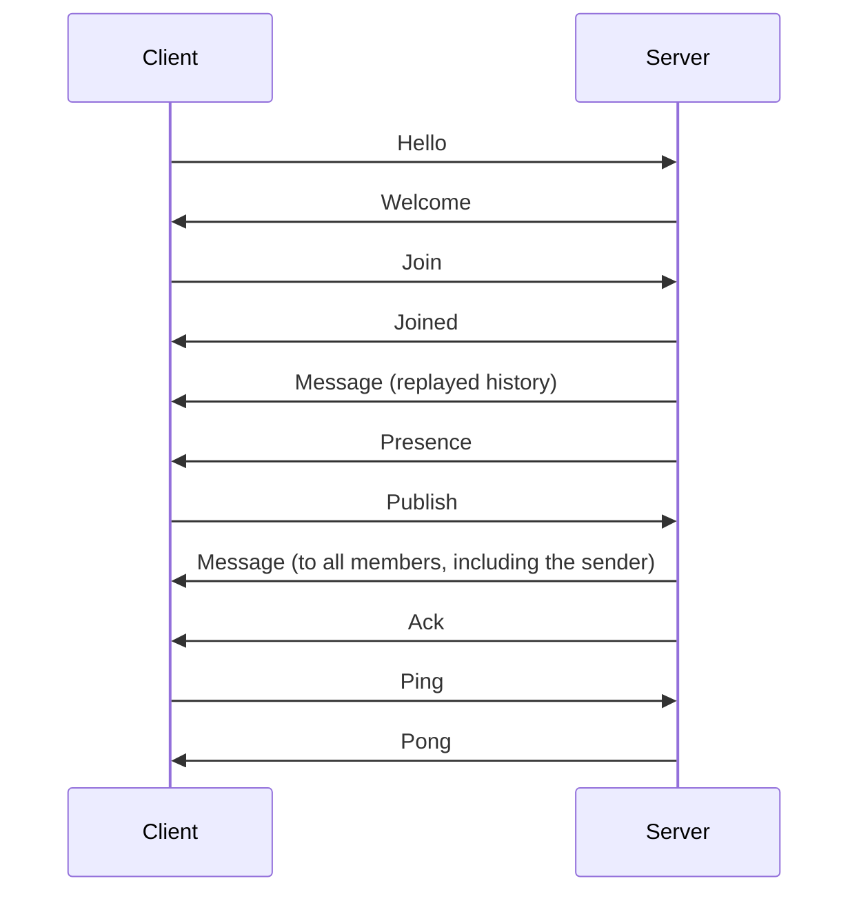

# Wire protocol, version 1

Orbit speaks a binary protocol over TCP, optionally inside TLS.

## Framing

```text
+----------------------+-----------+---------------------+
| length: u32          | type: u8  | payload             |
+----------------------+-----------+---------------------+
                       |<-------- length bytes --------->|
```

`length` excludes itself and must be at least 1. Frames above the server's limit (64 KiB
by default, advertised in `Welcome`) are a protocol violation, and are rejected from the
header alone, before the body is buffered.

## Encoding

Integers are big-endian. A `string` is a `u16` length then that many bytes, and a `blob`
is the same with a `u32` length. A `list<T>` is a `u32` count then that many elements.
Text is UTF-8. Decoders reject truncated frames and trailing bytes.

Room names and nicknames are 1 to 32 characters from `A-Z a-z 0-9 _ -`. Nicknames are
unique ignoring case; room names are case-sensitive.

## Session flow



`Hello` must be the first frame, and must come within the handshake timeout. A client
that is silent past the idle timeout is disconnected, so it should send `Ping` at the
`heartbeat_ms` interval from `Welcome`.

## Client messages

| Type | Name | Fields |
|---|---|---|
| `0x01` | Hello | `version: u16`, `nick: string`, `token: string` |
| `0x02` | Join | `room: string`, `since_seq: u64` |
| `0x03` | Leave | `room: string` |
| `0x04` | Publish | `correlation: u64`, `room: string`, `body: blob` |
| `0x05` | Direct | `correlation: u64`, `to: string`, `body: blob` |
| `0x06` | Who | `room: string` |
| `0x07` | ListRooms | none |
| `0x08` | Ping | `nonce: u64` |

## Server messages

| Type | Name | Fields |
|---|---|---|
| `0x81` | Welcome | `session_id: u64`, `heartbeat_ms: u32`, `max_frame_size: u32`, `server_version: string` |
| `0x82` | Error | `correlation: u64`, `code: u16`, `detail: string` |
| `0x83` | Joined | `room: string`, `head_seq: u64`, `first_seq: u64`, `member_count: u32` |
| `0x84` | Left | `room: string` |
| `0x85` | Message | `room: string`, `seq: u64`, `timestamp_ms: u64`, `nick: string`, `body: blob` |
| `0x86` | Presence | `room: string`, `nick: string`, `joined: u8`, `timestamp_ms: u64` |
| `0x87` | DirectMessage | `from: string`, `timestamp_ms: u64`, `body: blob` |
| `0x88` | Ack | `correlation: u64`, `seq: u64`, `timestamp_ms: u64` |
| `0x89` | WhoReply | `room: string`, `nicks: list<string>` |
| `0x8A` | RoomList | `rooms: list<{name: string, member_count: u32}>` |
| `0x8B` | Pong | `nonce: u64` |

## Ordering and replay

Each room numbers its messages from 1. All members observe the same sequence, in order.

`Join.since_seq` is the last sequence the client has seen, or 0 if it has none. The server
replies with `Joined`, then replays retained messages newer than `since_seq`, then streams
live traffic, with no gap or overlap between the two.

After `Joined`, a `Message` with `seq <= head_seq` is replayed history. If `first_seq` is
greater than `since_seq + 1`, messages between them have aged out and cannot be replayed.

`correlation` is chosen by the client and echoed in the matching `Ack` or `Error`. An
`Error` that answers a request with no correlation field, such as `Join`, carries 0.

With `fsync=always`, an `Ack` means the message is on disk. Under the other policies it
means the message was accepted and ordered, and a crash may still lose it.

## Errors

| Code | Name | Closes the connection |
|---|---|---|
| 1 | ProtocolViolation | Yes |
| 2 | UnsupportedVersion | Yes |
| 3 | AuthenticationFailed | Yes |
| 4 | NicknameTaken | Yes |
| 5 | InvalidName | During `Hello` only |
| 6 | InvalidMessage | No |
| 7 | NotInRoom | No |
| 8 | UnknownUser | No |
| 9 | RateLimited | Only after sustained flooding |
| 10 | Overloaded | No |
| 11 | ServerFull | Yes |
| 12 | ServerShutdown | Yes |
| 13 | StorageFailure | No |
| 14 | TimedOut | Yes |
